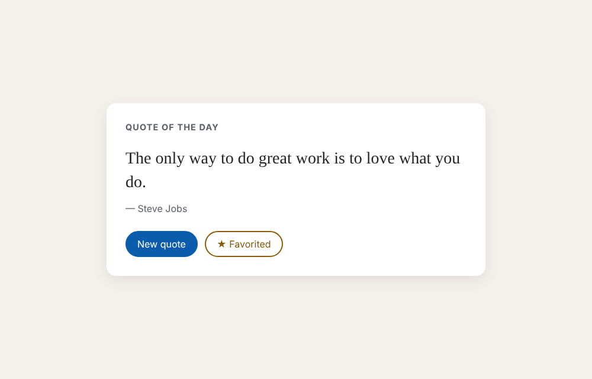

# Week 2 Write-up: Spec-Driven Development with Spec Kit

**Feature**: Quote of the Day (`specs/001-quote-of-the-day/`)
**Spec Kit**: v1.2.4.dev0 templates, Copilot skills layout (`.github/skills/speckit-*`)
**Result**: Converged after 3 converge passes. 15 unit tests and 9 browser tests pass.



## How I ran it

I ran each `/speckit-*` skill in order and reviewed every artifact before starting the next
stage. Each stage has its own commit, so `git log` shows the full loop.

| Stage | Commit message starts with | Output |
|---|---|---|
| init | `chore: initialize Spec Kit project` | `.specify/`, `.github/skills/` |
| constitution | `docs: ratify constitution v1.0.0` | `.specify/memory/constitution.md` |
| specify | `spec: add quote-of-the-day specification (v1)` | `spec.md`, `checklists/requirements.md` |
| plan | `plan: add implementation plan…` | `plan.md`, `research.md`, `data-model.md`, `contracts/`, `quickstart.md` |
| tasks | `tasks: generate task list (T001-T017)` | `tasks.md` |
| implement | `feat: implement quote-of-the-day page (T001-T017)` | page + tests |
| converge 1 | (no commit: converged, so `tasks.md` stayed unchanged) | none |
| **refine** | `spec+plan: refine FR-002…` | spec v1.1, plan, research R6, contracts |
| converge 2 | `tasks: converge pass 2 appends Phase 7 (T018-T021)` | 4 new tasks |
| implement | `feat: New quote never repeats the current quote (T018-T021)` | fix + tests |
| converge 3 | (no commit: converged) | none |

## Prompts I gave each skill

```text
/speckit-constitution Create principles focused on code quality, testing, and maintainability.
/speckit-specify A quote-of-the-day page: one random quote from a built-in list, a "New quote" button, and favoriting that persists across reloads.
/speckit-plan Use plain HTML/CSS/JavaScript, no backend; persist favorites in localStorage.
/speckit-tasks
/speckit-implement
/speckit-converge
```

After the refinement:

```text
/speckit-plan Spec v1.1 changed FR-002: New quote must never show the quote that is already on screen. Update the design and contracts for this.
/speckit-converge
/speckit-implement
/speckit-converge
```

What came out of each stage:

- **Constitution**: 5 principles: readable small code, test-first (each test names its FR),
  no unneeded dependencies, graceful failure, and accessible by default.
- **Specify**: 3 prioritised user stories (see quote, new quote, favorite), FR-001 to
  FR-006, and edge cases for blocked or corrupt storage. The quality checklist passed on
  the first try.
- **Plan**: the logic lives in DOM-free modules (`quotes`, `picker`, `favorites`) and
  `app.js` connects them to the page. Favorites are stored by **stable quote id**, not by
  array index (research R1). The Constitution Check flagged Playwright as a dependency, so
  the plan justifies it in Complexity Tracking as a dev-only test tool.
- **Tasks**: 17 tasks grouped by user story. In each one, the test task comes before the
  code task.

## Before/after: a spec refinement that changed the output

**The problem.** Spec v1 FR-002 said "New quote" shows "a randomly chosen quote from the
list". After the first implement pass all tests passed, but using the page felt broken:
sometimes pressing the button did nothing. I measured it with a script that presses the
button 300 times:

| | Spec v1 | Spec v1.1 |
|---|---|---|
| FR-002 | "shows a randomly chosen quote from the list" | "…MUST differ from the quote shown immediately before the press; chosen at random from all the other quotes" |
| Presses that left the quote unchanged | **29 / 300 (9.7%)**, about 1 in 12 as expected with 12 quotes | **0 / 300** |
| `/speckit-converge` | ✅ Converged | Found gaps, appended T018–T021 |

The surprising part is that **converge said "Converged" on the buggy version**. That was
correct: the code did exactly what v1 said. The bug was in the spec, so no amount of
converging could find it.

**What I changed.** I changed only the artifacts, not the code:

- spec: FR-002, a new acceptance scenario US2/AC3, a new edge case (a list with one quote),
  and SC-004 ("100% of presses change the quote")
- plan, research R6, and contracts: a new `pickNextQuote(quotes, currentId, random)` that
  picks uniformly from the *other* quotes with one `random()` call (no re-roll loop)

Then converge pass 2 compared the code with the new spec and appended a Convergence phase:

```markdown
## Phase 7: Convergence
- [ ] T018 Add unit tests for `pickNextQuote` … per FR-002 (missing)
- [ ] T019 Implement `pickNextQuote(quotes, currentId, random)` … (missing)
- [ ] T020 Make `#new-quote` in `src/app.js` use `pickNextQuote` … per FR-002, US2/AC3 (partial)
- [ ] T021 Add e2e test: 300 presses of New quote, every press changes the quote per SC-004 (missing)
```

I implemented those tasks. As a check, I ran the new browser test against the old
`app.js` and it failed with `expected: 0, actual: 27`. It passes on the new code.

## Convergence outcome

- **Pass 1** (spec v1): ✅ Converged. Every FR and acceptance scenario had a passing test,
  and there was no unrequested code.
- **Pass 2** (spec v1.1): 4 findings (3 `missing`, 1 `partial` on FR-002 and US2/AC3), and
  Phase 7 (T018–T021) was appended.
- **Pass 3**: ✅ **Converged.** 21/21 tasks are done, `npm test` gives 15/15 and
  `npm run test:e2e` gives 9/9.

## What I learned

<!-- Draft: rewrite this in your own words before submitting. -->
SDD felt like overhead for the easy parts. Writing a data model and a contracts file for a
12-quote page took longer than writing the code. It paid off when something went wrong.
Because the plan had already fixed the module boundaries and stable quote ids, the "New
quote repeats" fix was a small, traceable change: spec → plan → 4 tasks → done, and nothing
else had to move. The biggest lesson is that converge checks the code against the spec, not
against what I actually wanted. A vague spec converges just as cleanly as a good one, so the
human review between stages is where the real quality comes from.
